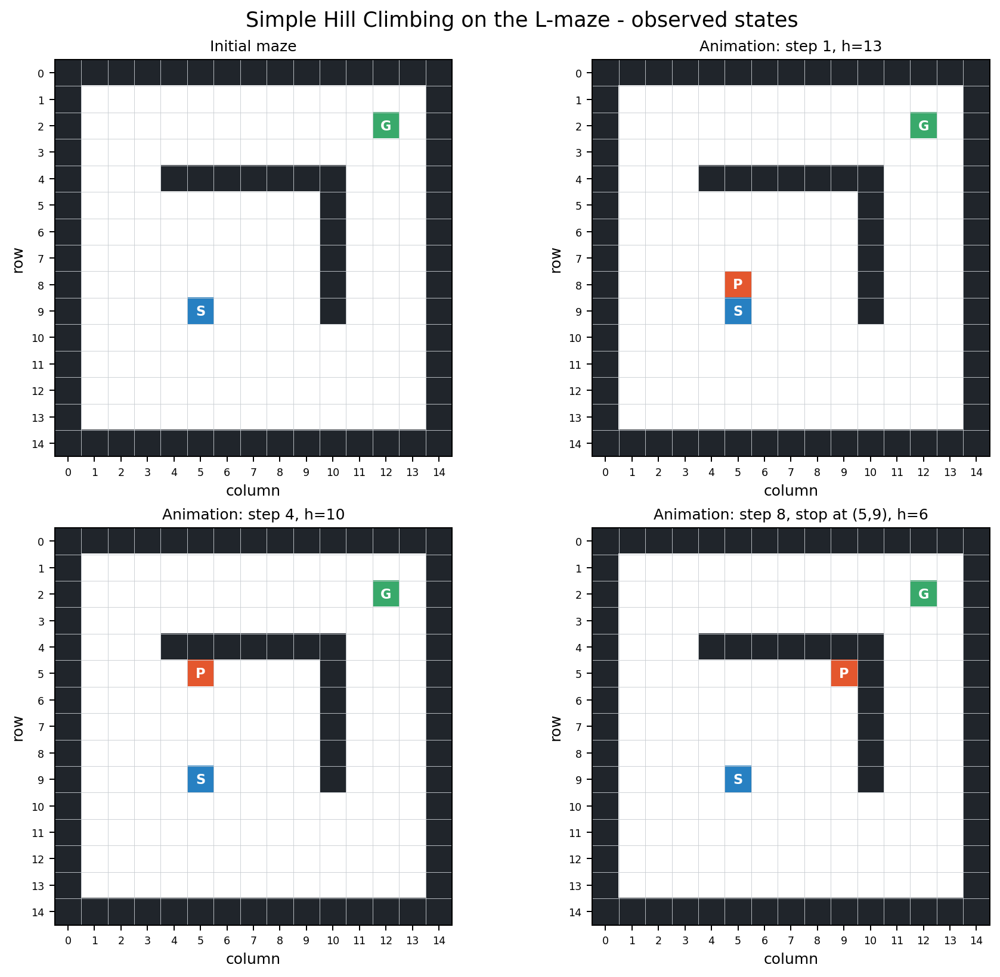
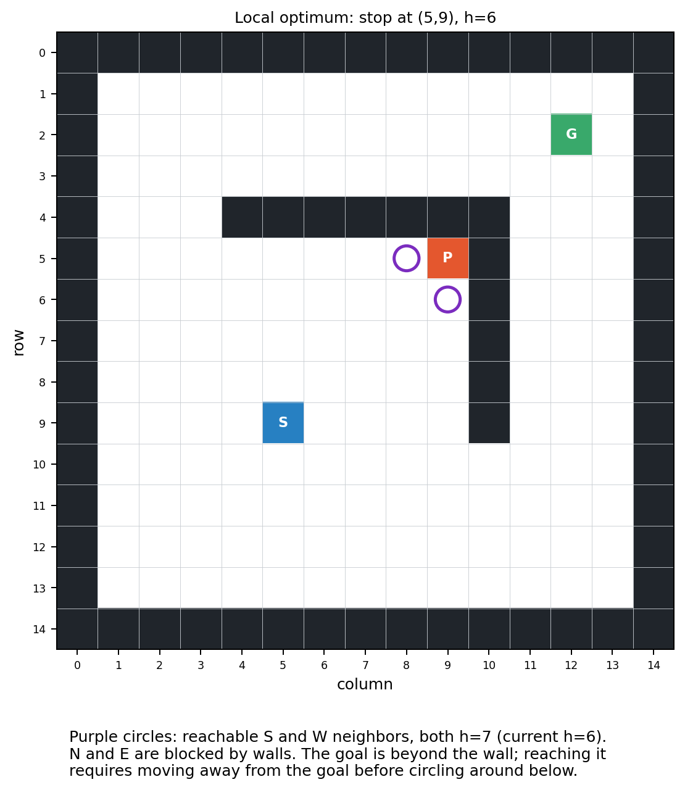

# WP1 - Simple Hill Climbing trên mê cung

## Mục tiêu và môi trường

Chạy `Maze_Example_LocalSearch.ipynb` từ đầu để quan sát Simple Hill Climbing trên L-maze. Notebook chạy thành công với kernel `Python (lab03-local-search)`. Mê cung được đọc từ `L_maze.txt` trong thư mục lab; animation chạy đến trạng thái dừng.

## Cách hoạt động trong notebook

- Trạng thái là tọa độ `(row, column)`. Điểm bắt đầu `S=(9,5)`, đích `G=(2,12)`.
- `expand(maze, pos)` cộng bốn vector hướng vào tọa độ hiện tại rồi trả về các ô kề không phải tường. Thứ tự mặc định là `N, E, S, W`. Hàm dựa vào tường bao quanh mê cung để loại ô ngoài biên, không kiểm tra biên riêng.
- Heuristic là Manhattan distance: `h(pos)=|row-row_goal|+|column-column_goal|`. Giá trị ban đầu là `14`; heuristic nhỏ hơn chỉ biểu thị gần hơn theo tọa độ, không tính đường vòng quanh tường.
- Ở mỗi bước, notebook tính heuristic của toàn bộ hàng xóm, lấy giá trị nhỏ nhất và chọn hàng xóm đầu tiên có giá trị đó theo thứ tự `N, E, S, W`. Chỉ di chuyển nếu `best_obj < current_obj`; nếu không có cải thiện nghiêm ngặt thì dừng. Vì vậy đây là biến thể chọn hàng xóm tốt nhất (steepest improvement), không phải chọn hàng xóm tốt đầu tiên rồi dừng.
- Nếu nhiều hướng hòa điểm, thứ tự quyết định hướng được chọn trước. Ở điểm bắt đầu, đi lên và đi sang phải cùng có `h=13`, nên thứ tự mặc định chọn đi lên. Thử cả 24 hoán vị thứ tự hướng trên mê cung này đều cho cùng điểm dừng `(5,9)`, `h=6`, sau 8 bước; thứ tự có thể đổi lựa chọn khi hòa nhưng không đổi kết quả cuối của trường hợp này.

## Kết quả quan sát

Đường đi được chấp nhận là:

`(9,5) → (8,5) → (7,5) → (6,5) → (5,5) → (5,6) → (5,7) → (5,8) → (5,9)`

Heuristic giảm từ `14` xuống `6`. Tại `(5,9)`, hướng bắc và đông bị tường chặn; hai ô còn lại là `(6,9)` và `(5,8)`, đều có `h=7`. Không hàng xóm nào tốt hơn hiện tại nên thuật toán dừng. Nó **không tới đích**: trường hợp này là local optimum (cực tiểu cục bộ theo phép di chuyển 4 hướng và heuristic đang dùng), không phải nghiệm. Có đường tới đích nếu vòng xuống phía dưới bức tường, nhưng bước đầu tiên theo hướng đó làm heuristic tăng; thuật toán chỉ nhận bước cải thiện nên không thể đi vòng. Kết quả `result["solution"]` là trạng thái dừng `(5,9)`, không đảm bảo đó là đích; `path` của notebook là `None` và animation helper in “No solution found.”

Notebook chỉ đưa vị trí hiện tại vào từng khung animation, không lưu vết toàn bộ các ô đã đi qua. Khung đầu tiên tương ứng với bước sau khi rời điểm bắt đầu.

## Hình minh họa

Mê cung ban đầu và ba trạng thái đại diện từ các bước animation:

Trạng thái dừng và heuristic của các ô lân cận có thể đi tới:

## Nhận xét

Simple Hill Climbing đơn giản và nhanh trên mỗi bước, nhưng chỉ dùng heuristic cục bộ để quyết định. Trong mê cung này, Manhattan distance hướng thuật toán tiến về phía có vẻ gần đích nhưng không phản ánh vật cản. Khi cần tạm đi xa đích để vòng qua tường, quy tắc chỉ nhận cải thiện nghiêm ngặt khiến thuật toán mắc kẹt. Kết quả còn phụ thuộc quy tắc phá hòa khi chọn hàng xóm, dù thử nghiệm đổi thứ tự hướng cho thấy điểm dừng của mê cung cụ thể này không thay đổi.
