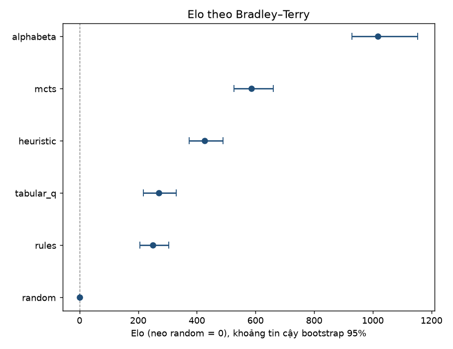
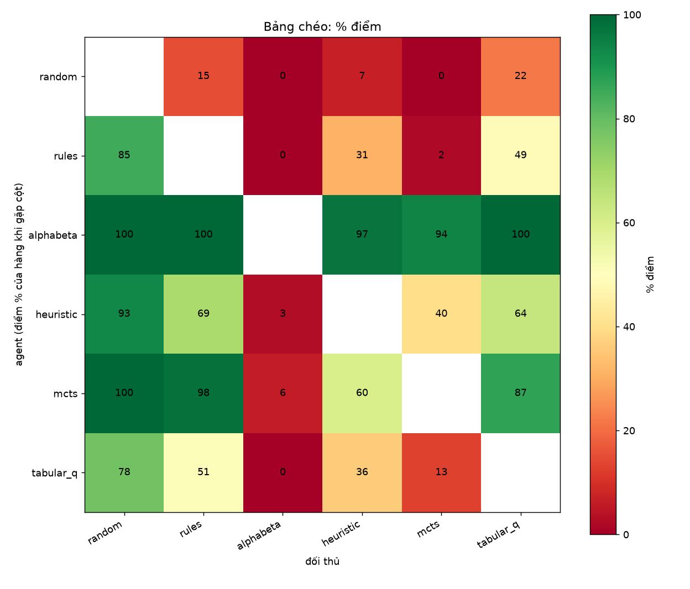
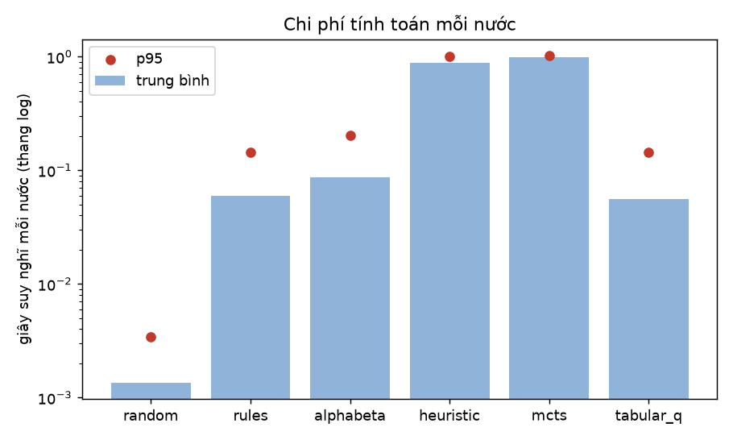

# Báo cáo giải đấu vòng tròn: round_robin_v1

## 1. Thông tin lần chạy

| Mục | Giá trị |
|---|---|
| Run ID | `20261112-091526_501370b5` |
| Chế độ | full |
| Commit / nhánh | `22d8943e37` / `feature/round-robin-tournament` |
| Thay đổi chưa commit | không |
| Máy | Linux-7.2.14-arch1-1-x86_64-with-glibc2.44, 12 luồng CPU |
| Python | CPython 3.14.9 |
| Config hash | `501370b5a7a644cf` |
| Số worker | 5 |
| Bắt đầu / kết thúc (UTC) | 2026-11-12T09:15:26+00:00 / 2026-11-12T10:09:39+00:00 |
| Tổng thời gian chạy | 54 phút 12 giây |
| Ván hoàn tất | 750/750 |
| Ván kết thúc bình thường | 748 |
| Ván hòa | 146 |
| Ván truncated | 2 |
| Ván lỗi (error) | 0 |

## 2. Thiết kế thực nghiệm

- **Đấu vòng tròn:** 6 agent, mỗi cặp 50 ván (25 thế khai cuộc × 2 màu), tổng 750 ván.
- **Vì sao cần khai cuộc cố định:** các agent tìm kiếm (`rules`, `alphabeta`, `tabular_q`) là tất định. Nếu cho hai agent tất định đánh nhiều lần từ thế ban đầu thì mọi ván giống hệt nhau và 50 ván chỉ là 1 ván lặp lại 50 lần. Sự đa dạng vì vậy phải đến từ thế khai cuộc: mỗi ván bắt đầu từ một khai cuộc cố định (bàn cờ cuối khác nhau, sách `xiangqi-curated-v2`).
- **Cân bằng màu:** mỗi thế được đánh hai lần trong mỗi cặp, A cầm Đỏ một ván và cầm Đen một ván, để lợi thế đi trước và thế khai cuộc lệch không thiên vị bên nào.
- **Giới hạn nước đi:** 300 nước (tính cả nước khai cuộc). Ván chưa phân thắng thua khi chạm giới hạn được ghi là **truncated** và *không phải hòa*; bảng chính tính truncated = 0.5 điểm (`T_half`), kèm cách tính loại bỏ chúng (`excl_T`).
- **Ván lỗi (error):** agent ném lỗi hoặc đi nước không hợp lệ; ván bị loại khỏi mọi phép tính điểm.

| Agent | Lớp | Budget | Tham số | Tất định? |
|---|---|---|---|---|
| `random` | RandomAgent | không có budget riêng | seed_mode=per_game | không |
| `rules` | RuleBasedAgent | không có budget riêng | mặc định | có |
| `alphabeta` | AlphaBetaAgent | không có budget riêng | max_depth=2 | có |
| `heuristic` | HeuristicAgent | không có budget riêng | max_depth=6, max_nodes=2000, time_limit=1.0 | không |
| `mcts` | MCTSAgent | time_limit=1.0 | config(c=1.4, rollout_policy=capture_first, rollout_depth=2, eval_scale=100), config_source=configs/mcts.yaml, time_limit=1.0, max_simulations=None, seed_mode=per_game | không |
| `tabular_q` | TabularQAgent | không có budget riêng | checkpoint sha256=eeb21b0fabbc…, epsilon=0.0, fallback=rules | có |

Mọi agent chạy đúng cấu hình mặc định mà web API đang dùng; giải đấu chỉ đo, không tinh chỉnh agent.

## 3. Bảng xếp hạng

| Hạng | Agent | Ván | W-D-L-T-E | Điểm | % điểm (T=0.5) | % điểm (loại T) | Hạng (loại T) | Elo | Elo 95% CI |
|---|---|---|---|---|---|---|---|---|---|
| 1 | `alphabeta` | 250 | 244-3-3-0-0 | 245.5 | 98.20% | 98.20% | 1 | 1018 | [930; 1153] |
| 2 | `mcts` | 250 | 169-13-68-0-0 | 175.5 | 70.20% | 70.20% | 2 | 586 | [526; 661] |
| 3 | `heuristic` | 250 | 102-64-83-1-0 | 134.5 | 53.80% | 53.82% | 3 | 427 | [374; 489] |
| 4 | `tabular_q` | 250 | 43-90-115-2-0 | 89.0 | 35.60% | 35.48% | 4 | 270 | [218; 330] |
| 5 | `rules` | 250 | 42-83-125-0-0 | 83.5 | 33.40% | 33.40% | 5 | 251 | [206; 305] |
| 6 | `random` | 250 | 2-39-208-1-0 | 22.0 | 8.80% | 8.63% | 6 | 0 | [0; 0] |

**Cách đọc.** Thắng = 1 điểm, hòa = 0.5, thua = 0; `% điểm` là điểm trên số ván hợp lệ (không tính ván lỗi). Hạng xếp theo `% điểm (T=0.5)`.

**Elo** được ước lượng theo mô hình Bradley–Terry (thuật toán MM của Hunter 2004), hòa tính bằng nửa thắng, quy đổi `Elo = 400·log10(sức mạnh)`. Để rating không chạy ra vô cực khi một bên thắng tuyệt đối, mỗi cặp (kể cả cặp chưa có ván) được cộng thêm **1 ván hòa ảo** (prior nhẹ). Thang Elo được neo sao cho `random` = 0, nên chỉ có chênh lệch giữa các agent là có nghĩa. Khoảng tin cậy 95% lấy bằng bootstrap (1000 lần lấy mẫu lại có hoàn lại các ván trong từng cặp, phân vị 2.5% và 97.5%); agent dùng làm neo luôn có khoảng [0; 0].

> Thứ hạng giống nhau dù tính truncated = 0.5 hay loại truncated.



## 4. Bảng chéo

Ô (hàng, cột) là % điểm của agent ở hàng khi gặp agent ở cột.

|  | `random` | `rules` | `alphabeta` | `heuristic` | `mcts` | `tabular_q` |
|---|---|---|---|---|---|---|
| `random` |  | 15.0% | 0.0% | 7.0% | 0.0% | 22.0% |
| `rules` | 85.0% |  | 0.0% | 31.0% | 2.0% | 49.0% |
| `alphabeta` | 100.0% | 100.0% |  | 97.0% | 94.0% | 100.0% |
| `heuristic` | 93.0% | 69.0% | 3.0% |  | 40.0% | 64.0% |
| `mcts` | 100.0% | 98.0% | 6.0% | 60.0% |  | 87.0% |
| `tabular_q` | 78.0% | 51.0% | 0.0% | 36.0% | 13.0% |  |



## 5. Kết quả từng cặp

| Cặp (A vs B) | Ván | W-D-L-T-E (của A) | Điểm A | % điểm A | Wilson 95% | Điểm A khi Đỏ / Đen | Số nước TB | Ván khác nhau | Kết luận |
|---|---|---|---|---|---|---|---|---|---|
| random vs rules | 50 | 0-15-35-0-0 | 7.5 | 15.0% | [7.6; 27.4] | 5.5 / 2.0 | 81.8 | 50/50 | rules mạnh hơn |
| random vs alphabeta | 50 | 0-0-50-0-0 | 0.0 | 0.0% | [0.0; 7.1] | 0.0 / 0.0 | 43.7 | 50/50 | alphabeta mạnh hơn |
| random vs heuristic | 50 | 0-7-43-0-0 | 3.5 | 7.0% | [2.6; 17.5] | 1.5 / 2.0 | 60.3 | 50/50 | heuristic mạnh hơn |
| random vs mcts | 50 | 0-0-50-0-0 | 0.0 | 0.0% | [0.0; 7.1] | 0.0 / 0.0 | 50.1 | 50/50 | mcts mạnh hơn |
| random vs tabular_q | 50 | 2-17-30-1-0 | 11.0 | 22.0% | [12.8; 35.2] | 8.0 / 3.0 | 85.7 | 50/50 | tabular_q mạnh hơn |
| rules vs alphabeta | 50 | 0-0-50-0-0 | 0.0 | 0.0% | [0.0; 7.1] | 0.0 / 0.0 | 62.2 | 50/50 | alphabeta mạnh hơn |
| rules vs heuristic | 50 | 2-27-21-0-0 | 15.5 | 31.0% | [19.9; 44.8] | 11.5 / 4.0 | 73.2 | 50/50 | heuristic mạnh hơn |
| rules vs mcts | 50 | 0-2-48-0-0 | 1.0 | 2.0% | [0.4; 10.5] | 1.0 / 0.0 | 61.5 | 50/50 | mcts mạnh hơn |
| rules vs tabular_q | 50 | 5-39-6-0-0 | 24.5 | 49.0% | [35.7; 62.4] | 15.0 / 9.5 | 38.9 | 31/50 | chưa đủ bằng chứng |
| alphabeta vs heuristic | 50 | 47-3-0-0-0 | 48.5 | 97.0% | [88.0; 99.3] | 24.5 / 24.0 | 76.8 | 50/50 | alphabeta mạnh hơn |
| alphabeta vs mcts | 50 | 47-0-3-0-0 | 47.0 | 94.0% | [83.8; 97.9] | 24.0 / 23.0 | 79.2 | 50/50 | alphabeta mạnh hơn |
| alphabeta vs tabular_q | 50 | 50-0-0-0-0 | 50.0 | 100.0% | [92.9; 100.0] | 25.0 / 25.0 | 63.9 | 50/50 | alphabeta mạnh hơn |
| heuristic vs mcts | 50 | 19-2-29-0-0 | 20.0 | 40.0% | [27.6; 53.8] | 13.0 / 7.0 | 82.7 | 50/50 | chưa đủ bằng chứng |
| heuristic vs tabular_q | 50 | 19-25-5-1-0 | 32.0 | 64.0% | [50.1; 75.9] | 20.5 / 11.5 | 77.2 | 50/50 | heuristic mạnh hơn |
| mcts vs tabular_q | 50 | 39-9-2-0-0 | 43.5 | 87.0% | [75.0; 93.7] | 23.5 / 20.0 | 66.0 | 50/50 | mcts mạnh hơn |

**Kết luận thống kê:** nếu khoảng Wilson 95% của `% điểm A` nằm hoàn toàn trên 50% thì A mạnh hơn, hoàn toàn dưới 50% thì B mạnh hơn, còn lại là *chưa đủ bằng chứng*. Khoảng Wilson chỉ là **xấp xỉ** khi có hòa (hòa được tính 0.5 "thành công", không phải phép thử nhị phân thuần túy). Ngoài ra có nhiều cặp được so sánh cùng lúc mà không hiệu chỉnh cho so sánh nhiều lần, nên cần thận trọng với các cặp sát ngưỡng.

## 6. Chi phí tính toán

| Agent | Số nước | TB (giây) | Trung vị (giây) | p95 (giây) | Tổng (giây) | Nodes TB | Mô phỏng TB | Tỉ lệ fallback |
|---|---|---|---|---|---|---|---|---|
| `random` | 6863 | 0.0014 | 0.0011 | 0.0034 | 9.3 | – | – | – |
| `rules` | 6794 | 0.0595 | 0.0541 | 0.1437 | 404.3 | – | – | – |
| `alphabeta` | 7076 | 0.0861 | 0.0756 | 0.2020 | 609.5 | 176.8 | – | – |
| `heuristic` | 8119 | 0.8881 | 1.0002 | 1.0017 | 7210.5 | 26.2 | – | – |
| `mcts` | 7384 | 0.9873 | 1.0089 | 1.0237 | 7290.1 | 317.5 | 412.0 | – |
| `tabular_q` | 7151 | 0.0559 | 0.0489 | 0.1430 | 400.0 | – | – | 99.2% |

Chỉ tính các nước do agent tự đi (không tính nước khai cuộc). Thời gian là thời gian suy nghĩ đo trong tiến trình worker, nên phụ thuộc máy và số worker chạy song song.



## 7. Phân tích màu và khai cuộc

| Agent | Ván cầm Đỏ | % điểm khi Đỏ | Ván cầm Đen | % điểm khi Đen | Đỏ − Đen (điểm %) |
|---|---|---|---|---|---|
| `random` | 125 | 12.0% | 125 | 5.6% | 6.4 |
| `rules` | 125 | 40.4% | 125 | 26.4% | 14.0 |
| `alphabeta` | 125 | 98.8% | 125 | 97.6% | 1.2 |
| `heuristic` | 125 | 62.8% | 125 | 44.8% | 18.0 |
| `mcts` | 125 | 74.8% | 125 | 65.6% | 9.2 |
| `tabular_q` | 125 | 44.8% | 125 | 26.4% | 18.4 |
| **Toàn giải (lợi thế đi trước)** | 750 | 55.6% | 750 | 44.4% | 11.2 |

Trên toàn giải, bên Đỏ (đi trước) đạt 55.6% số điểm.

| Thế khai cuộc | Họ | Ván | Đỏ thắng | Hòa | Đen thắng | Truncated | Lỗi | Ghi chú |
|---|---|---|---|---|---|---|---|---|
| `screen_horses_c57` | screen_horses | 30 | 47% | 27% | 27% | 0% | 0% |  |
| `screen_horses_c56` | screen_horses | 30 | 50% | 13% | 37% | 0% | 0% |  |
| `screen_horses_pawn7` | screen_horses | 30 | 53% | 13% | 33% | 0% | 0% |  |
| `reverse_palace_p7` | reverse_palace_horse | 30 | 43% | 13% | 40% | 3% | 0% |  |
| `reverse_palace_mirror` | reverse_palace_horse | 30 | 30% | 37% | 33% | 0% | 0% |  |
| `shun_cannon_straight_rook` | same_direction_cannon | 30 | 50% | 13% | 37% | 0% | 0% |  |
| `shun_cannon_rook_race` | same_direction_cannon | 30 | 50% | 3% | 47% | 0% | 0% |  |
| `lie_cannon_p7` | opposed_cannon | 30 | 57% | 23% | 20% | 0% | 0% |  |
| `pawn_vs_bottom_cannon_central` | pawn_vs_bottom_cannon | 30 | 40% | 30% | 30% | 0% | 0% |  |
| `pawn_vs_bottom_cannon_horses` | pawn_vs_bottom_cannon | 30 | 47% | 23% | 30% | 0% | 0% |  |
| `pawn_vs_pawn_c3` | pawn_vs_pawn | 30 | 50% | 20% | 30% | 0% | 0% |  |
| `pawn_vs_pawn_horses` | pawn_vs_pawn | 30 | 43% | 17% | 40% | 0% | 0% |  |
| `elephant_left` | flying_elephant | 30 | 47% | 17% | 37% | 0% | 0% |  |
| `elephant_vs_central_cannon` | flying_elephant | 30 | 37% | 30% | 33% | 0% | 0% |  |
| `elephant_vs_screen_setup` | flying_elephant | 30 | 50% | 20% | 30% | 0% | 0% |  |
| `horse_vs_central_cannon` | develop_horse | 30 | 40% | 20% | 40% | 0% | 0% |  |
| `horse_vs_cannon_left` | develop_horse | 30 | 43% | 20% | 37% | 0% | 0% |  |
| `corner_cannon_vs_central` | corner_cannon | 30 | 57% | 10% | 33% | 0% | 0% |  |
| `cross_palace_right` | cross_palace_cannon | 30 | 50% | 13% | 37% | 0% | 0% |  |
| `cross_palace_left` | cross_palace_cannon | 30 | 47% | 20% | 33% | 0% | 0% |  |
| `palace_cannon_left` | palace_cannon | 30 | 57% | 13% | 30% | 0% | 0% |  |
| `central_cannon_screen_horses` | central_cannon | 30 | 37% | 23% | 40% | 0% | 0% |  |
| `central_cannon_counter_cannon` | central_cannon | 30 | 37% | 27% | 37% | 0% | 0% |  |
| `pawn_left` | advance_pawn | 30 | 50% | 10% | 37% | 3% | 0% |  |
| `pawn_center` | advance_pawn | 30 | 33% | 30% | 37% | 0% | 0% |  |

Không có thế nào bị lệch (không bên nào thắng ≥ 70% số ván hợp lệ).

## 8. Cảnh báo và giới hạn

- **2 ván truncated** (đạt giới hạn nước đi, chưa phân thắng thua): không phải hòa. Bảng chính tính chúng 0.5 điểm (`T_half`), đồng thời có cách tính loại chúng ra (`excl_T`).
- **Có ván trùng nhau hoàn toàn** (`distinct_ratio` < 1): rules vs tabular_q (31/50 ván khác nhau). Các ván trùng không mang thêm thông tin độc lập, nên khoảng tin cậy có thể hẹp hơn thực tế. Nguyên nhân thường gặp: hai agent tất định (hoặc một agent gần như trùng agent kia, như tabular_q khi hầu hết nước rơi về `rules`) đổi màu cho nhau vẫn đi ra cùng một ván.
- **tabular_q gần như là `rules`:** 99.2% số nước của nó rơi về luật cơ bản (trạng thái không có trong bảng Q). Kết quả của tabular_q chủ yếu phản ánh `rules`, không phải năng lực của bảng Q đã học.
- **Agent không tất định:** `random`, `heuristic`, `mcts` không tái lập chính xác từng nước khi chạy lại (chỉ tái lập về mặt thống kê).
- `random` có seed riêng cho mỗi ván nên về nguyên tắc vẫn phát lại đúng nước, dù được đánh dấu là không tất định.
- **heuristic phụ thuộc đồng hồ:** agent này có giới hạn thời gian 1.0 giây mỗi nước nên nước đi có thể khác nhau tùy tốc độ và độ bận của máy (p95 thời gian nghĩ thực đo: 1.002 giây; trung vị 1.000 giây, tức phần lớn nước đi dừng vì hết giờ chứ không phải vì hết node).
- **mcts dùng thời gian:** mỗi nước chỉ được nghĩ trong thời gian cố định nên số mô phỏng trung bình là 412 mỗi nước. Chạy nhiều worker song song (lần chạy này: 5 worker) làm máy bận hơn, số mô phỏng giảm và mcts yếu đi; chạy lại với số worker khác có thể cho kết quả hơi khác. Muốn tái lập chính xác, đặt `max_simulations` trong config.

Giới hạn chung: Elo phụ thuộc prior 1 ván hòa ảo mỗi cặp; khoảng Wilson chỉ xấp xỉ khi có hòa; kết quả chỉ đúng với bộ thế khai cuộc, giới hạn nước đi và cấu hình agent của lần chạy này.

## 9. Lệnh tái lập

- Commit: `22d8943e3710b47ee65b29cc41260f77d6a99b8a` (nhánh `feature/round-robin-tournament`)
- Config: `configs/tournament.yaml` (hash `501370b5a7a644cf`), master_seed `20261110`

```powershell
cd project/backend
git checkout 22d8943e3710b47ee65b29cc41260f77d6a99b8a
python -m src tournament --config configs/tournament.yaml --workers 5
python -m src tournament-report results/tournaments/20261112-091526_501370b5
```

`tournament-report` chỉ đọc `manifest.json` và `games.jsonl` rồi sinh lại toàn bộ thư mục `summary/`; các file CSV sinh lại giống hệt từng byte.
